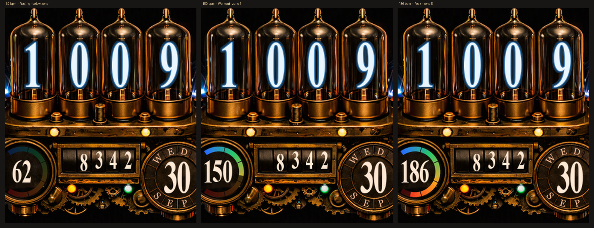

# Steampunk Nixie: a Garmin Venu Sq 2 watch face

**Four glowing nixie tubes on a brass steampunk machine, with arcs that crackle between the tube
tips every time you raise your wrist.**


[](https://github.com/JPTranter/GarminSteampunkWatchface/actions/workflows/ci.yml)
[](https://github.com/JPTranter/GarminSteampunkWatchface/releases)
[](LICENSE)

## Features

- **Nixie-tube time** in discharge blue. The glow breathes and flashes when a spark strikes.
- **Electric arcs** jump between the tube tips for the ~10 s after a wrist raise. The animation
  runs only while the screen is awake.
- **Heart-rate zone gauge**: a cold blue → green → orange → red band lit up to your current rate,
  one fifth of the arc per zone, using **your own zones** from Garmin Connect.
- **Odometer step counter** on mechanical drums.
- **Calendar dial**: the day in the centre, the weekday and month set one letter per segment into
  the dial's ring.
- **Always-on safe**: when idle, the face shows a small dim time, so the AMOLED's burn-in
  protection never blanks the screen.



*Images are renders made from the same resources the watch uses, shown as the AMOLED displays
them. They aren't photos.*

## Get it

| | |
|---|---|
| **Sideload a release** | Download the `.prg` for your watch from [Releases](https://github.com/JPTranter/GarminSteampunkWatchface/releases) and copy it into `GARMIN/APPS` over USB. [Step by step](docs/USER_MANUAL.md#2-install-a-release-no-tools-needed). |
| **Connect IQ Store** | Submission prepared ([docs/store](docs/store/SUBMISSION.md)). Once it's live, search *Steampunk Nixie* in the Connect IQ app. |
| **Build it yourself** | Connect IQ SDK + your own signing key: [User Manual §4](docs/USER_MANUAL.md#4-build-it-yourself). |

Supported: **Venu Sq 2** and **Venu Sq 2 Music** (320 × 360 AMOLED). The only permission is
*UserProfile*, used to read your heart-rate zones. No network, no storage, no background code.

## For developers

Everything is driven from one script in `ciq/`:

```bash
cd ciq
pip install -r requirements.txt
python make.py preview --hr 150     # offline render in a second, no SDK needed
python make.py all                  # assets -> build both watches -> preview -> push to the watch
python make.py release --publish    # signed .prg per watch + store .iq, tagged GitHub release
```

The [User Manual](docs/USER_MANUAL.md) covers building, changing and releasing it.
Engineering notes:

- [`ciq/LAYOUT.md`](ciq/LAYOUT.md): how the artwork was fitted to the screen, and every coordinate.
- [`docs/LESSONS_LEARNT.md`](docs/LESSONS_LEARNT.md): what went wrong and what fixed it, including
  the AMOLED colour shift, the compiler's silent palette reduction, and MTP sideload pitfalls.
- [`plugindocs/CONNECTIQ_FACTS.md`](plugindocs/CONNECTIQ_FACTS.md): the Connect IQ facts this
  relies on, with sources.
- [`SECURITY.md`](SECURITY.md): the signing key and the secret-scanning gates (gitleaks
  pre-commit and CI, the same as the sibling eClock project).

### How it was made

The design came out of a long render loop before any watch code existed:

- concept sweeps scored against a readability rubric ([`SPEC.md`](SPEC.md),
  [`PROJECT_STATUS.md`](PROJECT_STATUS.md));
- Blender Cycles spikes ([`docs/spike-notes/`](docs/spike-notes/)), which showed that photoreal
  glass and legible data fight each other;
- sourced technique notes ([`hybrid/research/`](hybrid/research/));
- an HTML model on the measured artwork ([`hybrid/web/`](hybrid/web/)).

## Artwork

The brass machine artwork (`reference/BrassBackground.png`) and the mood-board images in
`reference/` were generated with Microsoft Copilot. They keep their embedded C2PA provenance
("Made with AI"). The watch face fits, cleans and colour-corrects that artwork for the display;
see [`ciq/LAYOUT.md`](ciq/LAYOUT.md).

## Licence

[MIT](LICENSE).
