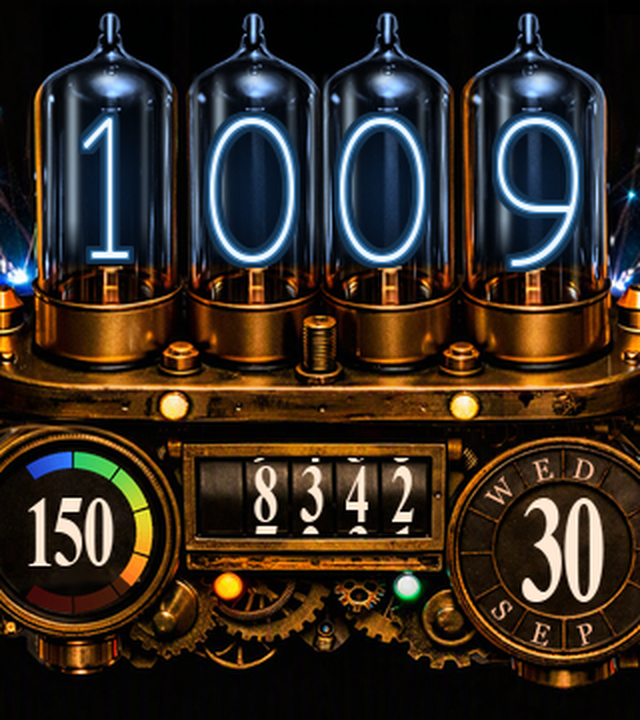

# User Manual: Steampunk Nixie for Garmin Venu Sq 2

1. [What the face shows](#1-what-the-face-shows)
2. [Install a release (no tools needed)](#2-install-a-release-no-tools-needed)
3. [Install from the Connect IQ Store](#3-install-from-the-connect-iq-store)
4. [Build it yourself](#4-build-it-yourself)
5. [Change it](#5-change-it)
6. [Make a release](#6-make-a-release)
7. [Troubleshooting](#7-troubleshooting)

---

## 1. What the face shows



| Element | What it shows |
|---|---|
| Four nixie tubes | The time, as 24-hour `HH MM`, in thin glowing nixie digits. |
| Five drums | Today's step count, up to 99,999. The digits sit on belts; when the count changes while the screen is awake, each changed digit rolls down into place. |
| Left gauge | Your current **heart rate**. The band is lit up to your rate in seven equal steps: 40–60 bpm (cold blue), 60 bpm to your zone 1 (green, a normal resting rate), then your five zones (green → yellow → orange → red). Your zones come from Garmin Connect (*User Settings → Heart Rate Zones*). |
| Right dial | The **day** in the centre. The **weekday** is set into the ring above it and the **month** below, one letter per segment. |
| Arcs and glow | For about 10 s after you raise your wrist, blue sparks crackle between the tube tips and the tubes' glow breathes, flashing when a spark touches it. |

When the watch is idle (always-on / low power), the face switches to a small dim time readout.
The AMOLED would turn the screen off if the full brass artwork stayed lit.

The face asks for one permission, **UserProfile**, to read your heart-rate zones. It has no
network access, stores nothing, and runs no background code.

**Supported watches:** Garmin **Venu Sq 2** and **Venu Sq 2 Music** (320 × 360 AMOLED).

---

## 2. Install a release (no tools needed)

1. Open the [Releases page](https://github.com/JPTranter/GarminSteampunkWatchface/releases) and
   download the `.prg` that matches your watch:
   - `SteampunkNixie-vX.Y.Z-venusq2m.prg` for the **Venu Sq 2 Music**
   - `SteampunkNixie-vX.Y.Z-venusq2.prg` for the **Venu Sq 2**

   If you're not sure which model you have, plug the watch in and open `GARMIN\GarminDevice.xml`
   on it. `<PartNumber>006-B4116-00</PartNumber>` is the Music, `006-B4115-00` is the plain
   Venu Sq 2.
2. Optionally, check the download against `SHA256SUMS.txt` from the same release
   (`certutil -hashfile <file> SHA256` on Windows, `shasum -a 256 <file>` on macOS/Linux).
3. Plug the watch in with its charging cable and keep it awake.
   - **Windows:** it appears under *This PC* as **Venu Sq 2**. It's an MTP device, so it has no
     drive letter; that's normal.
   - **macOS:** install [OpenMTP](https://openmtp.ganeshrvel.com/) or Android File Transfer.
     The watch doesn't mount in Finder.
4. Copy the `.prg` into **`Internal Storage\GARMIN\APPS`** on the watch.
5. Unplug it. On the watch, long-press the current face (or hold the watch-face button), then
   **Watch Face** → **Steampunk Nixie**.

A sideloaded face doesn't auto-update. To upgrade, copy the newer `.prg` over the old one.

---

## 3. Install from the Connect IQ Store

Once the face is published, search **Steampunk Nixie** in the Connect IQ Store app on your phone
and install it like any other face. Store installs update automatically.
*(Status: submission prepared, see [store/SUBMISSION.md](store/SUBMISSION.md).)*

---

## 4. Build it yourself

### Prerequisites

| Tool | Notes |
|---|---|
| **JDK 11+** | `java -version` |
| **Connect IQ SDK Manager** | <https://developer.garmin.com/connect-iq/sdk/>. Sign in with a Garmin account, install the latest SDK, and on the **Devices** tab tick **Venu Sq 2** and **Venu Sq 2 Music**. The default download skips older devices, and a missing device fails as `Invalid device id`. |
| **OpenSSL** | To create your signing key (Git for Windows ships it). |
| **Python 3.11+** | Only for the asset pipeline and previews: `pip install -r ciq/requirements.txt`. |

### Create your signing key (once)

Every build must be signed. Generate **your own** key and never commit it (`ciq/keys/` is
gitignored and the hooks block it):

```bash
cd ciq
mkdir -p keys
openssl genrsa -out keys/developer_key.pem 4096
openssl pkcs8 -topk8 -inform PEM -outform DER -in keys/developer_key.pem \
        -out keys/developer_key.der -nocrypt
```

Back the key up. Store updates must be signed with the same key forever (see
[SECURITY.md](../SECURITY.md)).

### Build and install

All commands run from `ciq/`. On Windows, use the Python that has the packages, e.g.
`/c/Python314/python.exe`.

```bash
python make.py build     # compile for both watches; one line each: size + sha256
python make.py push      # build for venusq2m, copy to the plugged-in watch, verify by hash
```

`make.py push` targets the **Venu Sq 2 Music** (`venusq2m`). For the plain Venu Sq 2, copy
`SteampunkNixie_venusq2.prg` by hand (section 2, step 4), or change `WATCH` in `make.py`.
`push` is Windows-only (it drives the MTP device through PowerShell).

Without Python you can still build with the SDK alone:

```bash
"<sdk>/bin/monkeyc" -d venusq2m -f monkey.jungle -o SteampunkNixie.prg -y keys/developer_key.der
```

### Try it in the simulator

Start the simulator (`<sdk>/bin/connectiq`), then:

```bash
"<sdk>/bin/monkeydo" SteampunkNixie.prg venusq2m
```

Pushing to the simulator takes from ~50 s to several minutes. It isn't hung, so let it finish.
*Simulation → Activity Data* feeds heart rate and steps.

---

## 5. Change it

Change a constant, look at it in a second, then put it on the watch:

```bash
python make.py preview --hr 150          # offline render -> artwork/face_preview.png
python make.py preview --anim 40         # the arc/glow animation -> artwork/anim_preview.gif
python make.py assets                    # regenerate every resource after changing a generator
python make.py all                       # assets + build + preview + push
python make.py screenshots               # README + store images, rendered as seen on the watch
```

Where things live:

| You want to change | Edit |
|---|---|
| Positions, colours, fonts used | `ciq/source/SteampunkNixieView.mc` (constants at the top) |
| Arc and glow animation | `ciq/source/Discharge.mc` (tuning constants at the top) |
| Heart-rate gauge geometry/colours | `ciq/hr_gauge.py`, then `make.py assets` |
| Date ring letters | `ciq/make_date_ring.py`, then `make.py assets` |
| Font sizes | `ciq/make_fonts.py`, then `make.py assets` |
| AMOLED colour correction | `ciq/device_colour.py` (`make_calibration.py` builds a test strip) |

Files marked `GENERATED` (`DateRing.mc`, `HrGauge.mc`, the ring patches, the fonts) are rebuilt
by `make.py assets`. Don't edit them by hand. [`ciq/LAYOUT.md`](../ciq/LAYOUT.md) records every
coordinate and why it is where it is, and [`docs/LESSONS_LEARNT.md`](LESSONS_LEARNT.md) records
what went wrong and how it was fixed.

---

## 6. Make a release

1. Bump `version="X.Y.Z"` on `<iq:application>` in `ciq/manifest.xml`, commit, and push.
2. Dry run: `python make.py release` builds into `release/`:
   - one release-mode `.prg` per watch
   - the store `.iq` package
   - `SHA256SUMS.txt`
   - `NOTES.md`, generated from the commit messages since the last tag
3. Publish: `python make.py release --publish`. This tags `vX.Y.Z`, pushes the tag and creates the
   GitHub release with those files attached (uses the `gh` CLI, already logged in).

Releases are built locally, not in GitHub Actions. The Connect IQ SDK can only be downloaded
through Garmin's login-gated SDK Manager, and the signing key must not leave your machine. CI
checks for secrets and that the tooling compiles.

---

## 7. Troubleshooting

| Symptom | Cause and fix |
|---|---|
| `Invalid device id specified: 'venusq2m'` | The device isn't downloaded. Open the SDK Manager → Devices → tick Venu Sq 2 / Venu Sq 2 Music. |
| `make.py push`: *device not found … but it IS on the USB bus* | The watch dropped its MTP connection. Unplug and replug the cable. |
| The face isn't in the watch-face list | Wrong model's `.prg`, or the copy went somewhere other than `GARMIN\APPS`. |
| Heart-rate band shows only a little blue | Your rate is below 60 bpm. Green starts at 60. |
| Colours look yellow-green on the PC | Expected. The shipping artwork is pre-corrected for the AMOLED, which renders warm tones redder. `make.py screenshots` renders the as-seen version. |
| `monkeydo` seems stuck | It's slow, not hung. Give it several minutes. |
